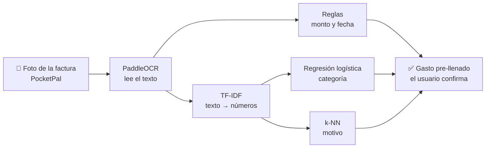
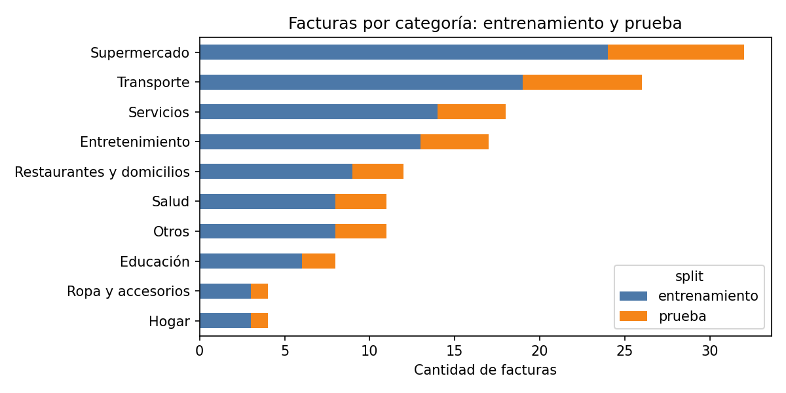
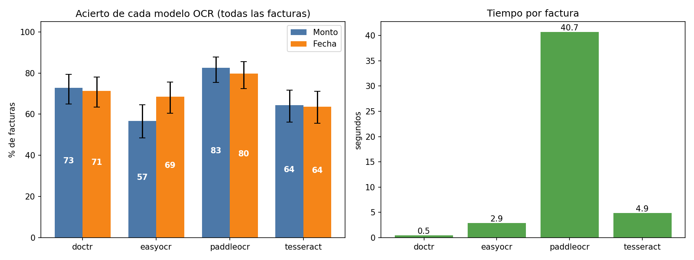
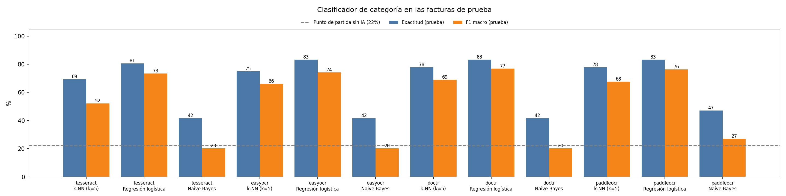
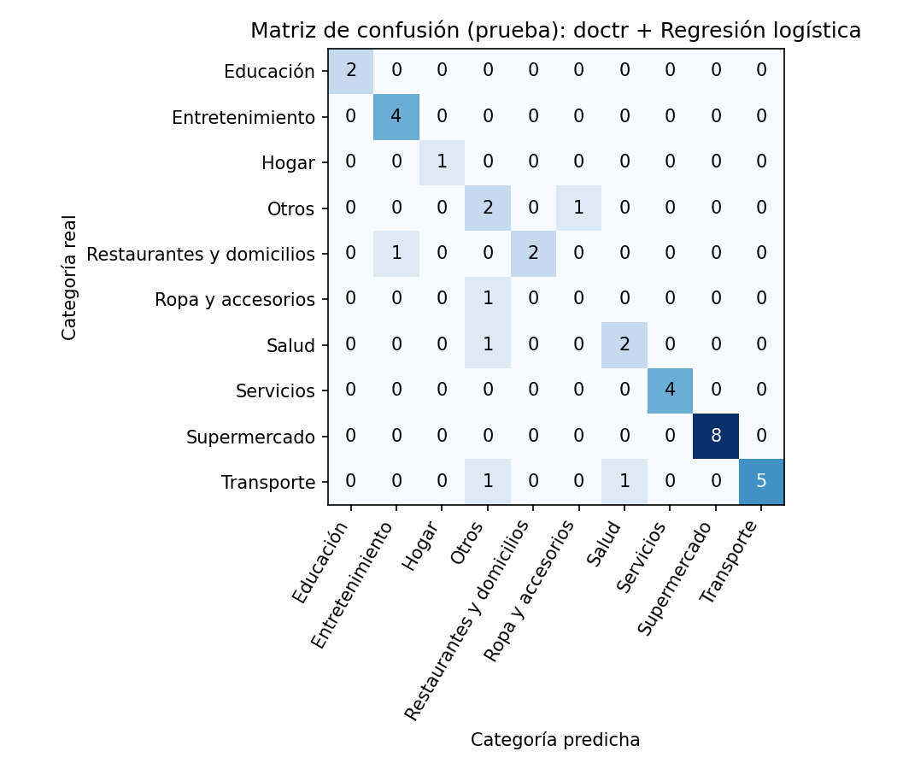
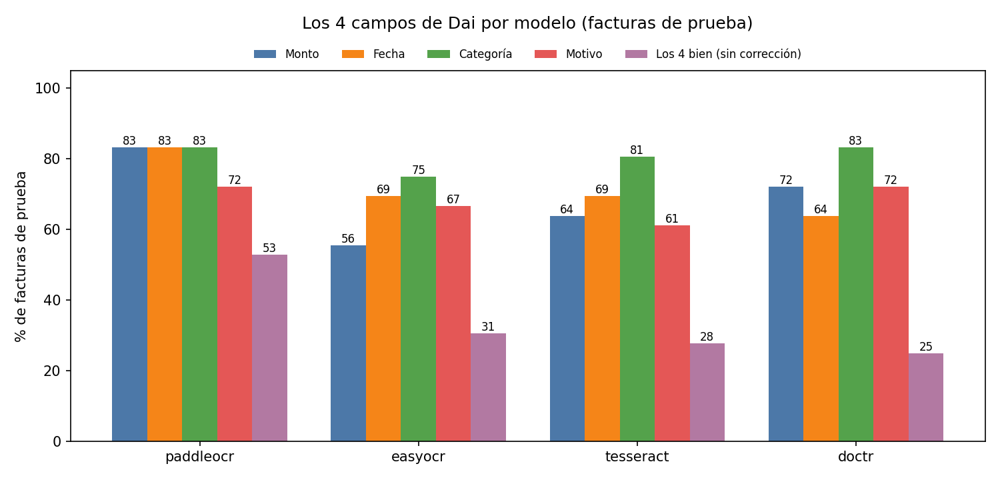
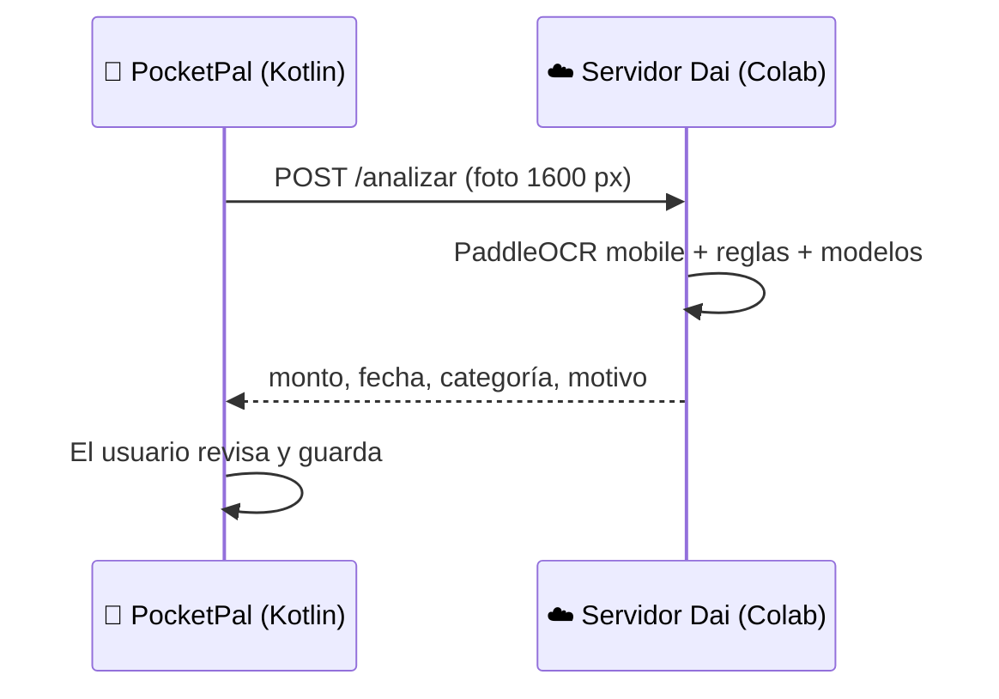

<p align="center">
  
</p>

<p align="center">
  <b>Proyecto final · Inteligencia Artificial · Universidad Jorge Tadeo Lozano</b><br>
  Juan Camilo Alarcón · Juan Felipe González · María Fernanda De la Pava<br>
  Profesor: José Alejandro Franco Calderón
</p>

<p align="center">
  📱 <b>Código de la app PocketPal (Android, Kotlin):</b> <a href="https://github.com/Mikemil0/PocketPal">github.com/Mikemil0/PocketPal</a>
</p>

---

## ¿Qué es Dai?

**Dai** es el asistente de inteligencia artificial de **PocketPal**, nuestra app de finanzas personales.
El usuario le toma una foto a una factura y Dai llena el gasto automáticamente con **4 campos**:

| Campo | Ejemplo | Cómo lo obtiene Dai |
|---|---|---|
| 💰 **Monto** | $48.710 | OCR + reglas de extracción |
| 📅 **Fecha** | 2026-11-02 | OCR + reglas de extracción |
| 🏷️ **Categoría** | Supermercado | TF-IDF + **Regresión logística** |
| ✏️ **Motivo** | "Mercado de la semana" | TF-IDF + **k-NN** (factura más parecida) |

El usuario siempre revisa y confirma antes de guardar.

## ¿Cómo funciona?



## Los datos

Construimos nuestro propio dataset con facturas reales colombianas recolectadas por formulario.

| Característica | Valor |
|---|---|
| Facturas | **143** (173 imágenes: algunas facturas largas tienen 2 fotos) |
| Categorías | **10** (de Supermercado con 32 hasta Hogar y Ropa con 4) |
| División | **107 entrenamiento / 36 prueba** (75/25, estratificada, semilla 42) |
| Tamaño de las fotos | 409 a 4.032 px · 65 tamaños distintos · 0,66 MB en promedio |
| Fotos de baja resolución | 37 de 173 (21 %), incluidas a propósito: así llegan en la vida real |

<p align="center"></p>

### 🗂️ Vista del dataset

Cada factura tiene su foto y las 4 respuestas correctas (las **etiquetas**) que Dai debe aprender a llenar. Una factura por categoría:

| # | Foto | Categoría | Monto | Fecha | Motivo | Conjunto |
|---|---|---|---:|---|---|---|
| 1 | `factura_001_1.jpg` | Ropa y accesorios | $ 20.000 | 2026-10-10 | Compra de piedras decorativas para ropa | prueba |
| 2 | `factura_002_1.jpeg` | Restaurantes y domicilios | $ 97.000 | 2026-10-24 | Compra de desayuno | entrenamiento |
| 3 | `factura_003_1.jpg + factura_003_2.jpg` | Supermercado | $ 985.694 | 2026-06-15 | Mercado del mes de junio | entrenamiento |
| 4 | `factura_004_1.jpg` | Transporte | $ 64.000 | 2026-10-15 | Gasolina del carro | prueba |
| 5 | `factura_005_1.jpg` | Entretenimiento | $ 93.200 | 2026-10-06 | Boletas de cine | entrenamiento |
| 6 | `factura_006_1.jpg` | Hogar | $ 90.910 | 2026-03-22 | Compra utensilios de cocina | entrenamiento |
| 9 | `factura_009_1.jpg` | Salud | $ 70.450 | 2025-05-19 | Compras de bebé recién nacido | entrenamiento |
| 11 | `factura_011_1.jpg` | Otros | $ 40.000 | 2025-02-22 | Salud de mascotas | prueba |
| 64 | `factura_064_1.jpg + factura_064_2.jpg` | Servicios | $ 48.710 | 2026-09-18 | Gas natural septiembre | entrenamiento |
| 80 | `factura_080_1.jpg` | Educación | $ 1.700.000 | 2026-06-01 | Pension Junio 2026 | entrenamiento |

📂 **[Ver el dataset completo (143 facturas)](datos/dataset_facturas.csv)**: GitHub lo muestra como una tabla en la que se puede buscar.

> Para proteger la privacidad, el dataset publicado **no incluye** nombres, correos ni las fotos de las facturas.


## Paso 1 · Elegir el modelo OCR

Comparamos **4 modelos OCR de código abierto** con las **mismas imágenes y las mismas reglas**, así la diferencia se debe solo a qué tan bien lee cada uno.

<p align="center"></p>

| Modelo | Monto | Fecha | Tiempo por factura |
|---|---|---|---|
| **PaddleOCR** | **82,5 %** | **79,7 %** | 40,7 s (CPU) |
| docTR | 72,7 % | 71,3 % | 0,5 s (GPU) |
| Tesseract | 64,3 % | 63,6 % | 4,9 s (CPU) |
| EasyOCR | 56,6 % | 68,5 % | 2,9 s (GPU) |

*143 facturas. Las barras negras son el intervalo de confianza del 95 % (Wilson).*
La ventaja de PaddleOCR es **estadísticamente significativa** (prueba de McNemar frente a docTR: monto p = 0,016; fecha p = 0,004).

## Paso 2 · Elegir el clasificador de categoría

Probamos 3 clasificadores sobre el texto de PaddleOCR. **El modelo se escogió solo con validación cruzada** (3 pliegues, dentro del entrenamiento) para no "hacer trampa" con las facturas de prueba.

<p align="center"></p>

| Clasificador | Exactitud entrenamiento | Exactitud prueba | F1 prueba | F1 validación cruzada |
|---|---|---|---|---|
| **Regresión logística** | 98,1 % | **83,3 %** | **76,3** | **65,1** |
| k-NN (k = 5) | 100 % | 77,8 % | 67,6 | 60,4 |
| Naive Bayes | 56,1 % | 47,2 % | 27,1 | 23,7 |

**Diagnóstico de sobreajuste:** k-NN saca 100 % en entrenamiento porque memoriza; la Regresión logística generaliza mejor a facturas que nunca vio.

<p align="center"></p>

## Paso 3 · El motivo

El motivo es texto libre, así que no hay una única respuesta correcta. Dai usa **k-NN (k = 1)**: copia el motivo de la factura de entrenamiento más parecida.
Se considera **aceptable** si comparte al menos una palabra clave con el motivo real.

| | Motivo aceptable |
|---|---|
| Línea base (usar el nombre de la categoría) | 6 % |
| **Dai (k-NN)** | **72 %** |

## Resultado final: los 4 campos juntos

La métrica principal del proyecto es el **% de facturas que el usuario no tendría que corregir** (los 4 campos bien a la vez).

<p align="center"></p>

| Modelo OCR | Monto | Fecha | Categoría | Motivo | **Sin corrección** |
|---|---|---|---|---|---|
| **PaddleOCR** | 83 % | 83 % | 83 % | 72 % | **53 %** (IC 37–68) |
| EasyOCR | 56 % | 69 % | 75 % | 67 % | 31 % |
| Tesseract | 64 % | 69 % | 81 % | 61 % | 28 % |
| docTR | 72 % | 64 % | 83 % | 72 % | 25 % |

*36 facturas de prueba.*

### ✅ Modelo seleccionado: **PaddleOCR + Regresión logística + k-NN**

## Lo que demuestran los datos

1. **PaddleOCR** deja 53 % de las facturas sin corrección: **1,7 veces** el segundo modelo.
2. Su ventaja en monto y fecha es **estadísticamente significativa**.
3. En el **96 %** de las facturas el monto correcto sí está en el texto leído: el mayor margen de mejora está en las reglas de extracción.
4. La **Regresión logística** sube la categoría de 22 % (línea base) a **83 %**.
5. **k-NN** lleva el motivo de 6 % a **72 %**.
6. Corregir las etiquetas de las facturas de servicios subió la fecha de 64 % a 80 %: **la calidad de los datos pesa tanto como el modelo**.

## Integración con PocketPal

Dai corre como un **servidor** (FastAPI en Google Colab) y la app Android le envía la foto.
El código de la app y su conexión con Dai están en el repositorio de **[PocketPal](https://github.com/Mikemil0/PocketPal)**.



- En la app se usa **PaddleOCR mobile**: unos **6 s por factura** (el modelo completo de la comparación tarda ~40 s en CPU).
- Si no hay conexión, la app usa la lectura local con **ML Kit** y el usuario completa los campos.
- La dirección del servidor se configura en la app: **Dai → Ajustes → Servidor de Dai**.

## Limitaciones y trabajo futuro

| Limitación | Mejora propuesta |
|---|---|
| 36 facturas de prueba | Ampliar el dataset |
| Hogar y Ropa con solo 4 facturas | Más ejemplos por categoría |
| Depende de un servidor | PaddleOCR mobile dentro del celular |
| El motivo es subjetivo | El usuario siempre confirma |
| Solo facturas colombianas (COP) | Otros países y monedas |

## Contenido de esta carpeta

```
dai_ia/
├── README.md
├── cuadernos/
│   ├── 01_dataset_facturas.ipynb          → limpieza y organización del dataset
│   ├── 02_comparacion_ocr_facturas.ipynb  → comparación OCR, clasificadores y motivo
│   └── 03_dai_servidor_colab.ipynb        → servidor que usa la app en la demo
├── datos/dataset_facturas.csv             → el dataset etiquetado (sin datos personales)
├── imagenes/                              → gráficas de los resultados
└── resultados/                            → tablas en CSV
```

## Cómo reproducirlo

1. Abrir el cuaderno en **Google Colab** (Entorno de ejecución → **GPU T4**).
2. `01` → organiza el dataset. `02` → corre la comparación completa. `03` → prende el servidor para la app.
3. La semilla es **42**: con el mismo dataset se obtienen las mismas facturas de prueba y los mismos resultados.

**Herramientas:** Python · PaddleOCR · EasyOCR · docTR · Tesseract · scikit-learn · pandas · matplotlib · FastAPI · Kotlin · Jetpack Compose · CameraX

> Las fotos de las facturas no se publican porque contienen datos personales de quienes las donaron.
